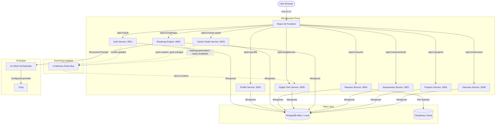

# 🚀 CareerOS AI — Complete Progress & Learning Guide

> **Target Audience:** Beginner to Intermediate Developers, Team Members, and Anyone Curious!  
> **Language:** Simple English + Hinglish Explanations (Easy analogies so you truly *understand* the code, not just copy-paste it).

---

## 📌 Table of Contents

1. [Big Picture: CareerOS AI Kya Hai? (The Vision)](#1-big-picture-careeros-ai-kya-hai-the-vision)
2. [High-End Engineering Concepts Made Simple](#2-high-end-engineering-concepts-made-simple)
   - [Monorepo & npm Workspaces](#a-monorepo--npm-workspaces)
   - [Microservices Architecture (Why not 1 big server?)](#b-microservices-architecture-why-not-1-big-server)
   - [Domain-Driven Design (DDD) & Data Ownership](#c-domain-driven-design-ddd--data-ownership)
   - [Event-Driven Architecture (Pub/Sub)](#d-event-driven-architecture-pubsub)
   - [The "Career Digital Twin" Concept](#e-the-career-digital-twin-concept)
   - [AI Client Orchestrator](#f-ai-client-orchestrator)
   - [Reverse Proxy with Vite](#g-reverse-proxy-with-vite)
3. [Current Implementation & Verification](#3-current-implementation--verification)
4. [Historical Terminal Log Example](#4-historical-terminal-log-example)
5. [Current System Architecture & Port Mapping](#5-current-system-architecture--port-mapping)
6. [What Should We Do Next? (Next Steps Roadmap)](#6-what-should-we-do-next-next-steps-roadmap)
7. [Developer Playbook & Cheatsheet](#7-developer-playbook--cheatsheet)

---

## 1. Big Picture: CareerOS AI Kya Hai? (The Vision)

Imagine you want to prepare for a **Full Stack Developer** interview at Google or Amazon.
Currently, people do this:
1. They go to LeetCode for DSA.
2. They go to Coursera/Udemy for tutorials.
3. They use random resume builders for ATS scores.
4. They ask ChatGPT random questions for mock interviews.

**The Problem:** None of these tools talk to each other! ChatGPT doesn't know what you studied yesterday, LeetCode doesn't know your resume projects, and your resume doesn't reflect your actual mock interview weakness.

### 💡 CareerOS Solution: The "Career Digital Twin"
**CareerOS AI** is an intelligent ecosystem that creates a **live digital replica of you** (your skills, learning roadmap progress, resume, target dream companies, and mock interview performance).
- If you finish a topic in your **Learning Roadmap**, your Digital Twin updates.
- When you do a **Mock Interview**, the AI asks questions targeting your weak areas from your roadmap and resume.
- If you fail an interview question on "Docker", the system updates your roadmap to recommend Docker practice!

---

## 2. High-End Engineering Concepts Made Simple

Let's understand the high-level architecture decisions we made in this codebase. (Bohot important for interviews and real-world system design!)

### A. Monorepo & npm Workspaces
* **What is it?** Instead of creating 8 different Git repositories (one for web, one for auth, one for ai, etc.), we put everything in **one single Git repository**.
* **How it's structured:**
  ```text
  CareerOS/
  ├── apps/              # User-facing applications (apps/web)
  ├── services/          # Independent Backend Microservices (auth, profile, goals, etc.)
  └── packages/          # Shared libraries used across services (logger, errors, ai-client, etc.)
  ```
* **Why do this?** Code reusability! If we define a TypeScript type (like `User` or `Roadmap`) inside `packages/shared-types`, both the Frontend (`apps/web`) and Backend (`services/roadmap-engine`) can import it directly. No copy-pasting types!

---

### B. Microservices Architecture (Why not 1 big server?)
* In a traditional beginner project (Monolith), everything runs on a single `app.js` or `server.ts` on port 5000.
* In **CareerOS**, we follow **Microservices**:
  - `services/auth` runs on **Port 3001**
  - `services/profile` runs on **Port 3002**
  - `services/career-goals` runs on **Port 3003**
  - `services/resume` runs on **Port 3004**
  - `services/digital-twin` runs on **Port 3005**
  - `services/roadmap-engine` runs on **Port 3006**
  - `services/assessment` runs on **Port 3007**
  - `services/projects` runs on **Port 3008**
  - `services/interview` runs on **Port 3009**
  - `services/health-check` defaults to **Port 3000** and is started separately
* **Simple Analogy:** Think of an airport. You have a Security Check counter, a Baggage Drop counter, and a Boarding Gate. If the Baggage counter gets crowded, Security still works! Similarly, if the Resume upload service takes time parsing a PDF, your Auth or Roadmap service doesn't freeze.

---

### C. Domain-Driven Design (DDD) & Data Ownership
* **Golden Rule of DDD:** *Each service owns its data. No other service can touch another service's database collection directly.*
* For example:
  - Only `services/career-goals` can write to the `goals` collection.
  - If the Digital Twin needs to know the user's active goal, it cannot run `db.goals.find()`. It must either ask via an API or listen to an Event!
* **Why?** Loose coupling (aazadi). If tomorrow `career-goals` changes its database schema, no other service breaks.

---

### D. Event-Driven Architecture (Pub/Sub)
* **How do services talk without being tightly coupled?** Through **Events**!
* **Analogy:** YouTube Notification Bell 🔔.
  - When a creator uploads a video (**Event: `video.uploaded`**), YouTube doesn't call 1 million subscribers individually. It publishes the event, and whoever subscribed gets notified.
* In CareerOS:
  - Business modules publish documented events; the Digital Twin processes the events its implemented subscribers handle.
* The current code uses an in-memory event bus (`packages/event-bus`). Moving to a broker such as Redis or Kafka requires additional integration work.

---

### E. The "Career Digital Twin" Concept
The architecture describes context for identity and goals, skills, learning, evidence, and readiness. Only partitions supported by implemented events and services are populated.

Context retrieval is available through the Digital Twin APIs. This does not mean every listed partition or every interview mode currently consumes that context.

---

### F. AI Client Orchestrator
* AI provider calls go through `packages/ai-client`, not directly from business route handlers.
* Instead, we built `packages/ai-client`:
  - Provider/model configuration with Groq as the configured provider.
  - Structured output validation and prompt templates.
  - Retry/fallback behavior in the supported calling services.

---

### G. Reverse Proxy with Vite
* When your React app in `apps/web` (running at `http://localhost:5173`) calls `/api/v1/auth/login` or `/api/v1/roadmaps/generate`:
* Does browser give CORS errors? **No!**
* Inside `apps/web/vite.config.ts`, Vite acts as a reverse traffic cop:
  - `/api/v1/auth` ➡️ Forwarded to `http://localhost:3001`
  - `/api/v1/profile` ➡️ Forwarded to `http://localhost:3002`
  - `/api/v1/career-goals` ➡️ Forwarded to `http://localhost:3003`
  - `/api/v1/resume` ➡️ Forwarded to `http://localhost:3004`
  - `/api/v1/digital-twin` ➡️ Forwarded to `http://localhost:3005`
  - `/api/v1/roadmaps` ➡️ Forwarded to `http://localhost:3006`
  - `/api/v1/assessments` ➡️ Forwarded to `http://localhost:3007`
  - `/api/v1/projects` ➡️ Forwarded to `http://localhost:3008`
  - `/api/v1/interviews` ➡️ Forwarded to `http://localhost:3009`

---

## 3. Current Implementation & Verification

The repository currently contains the following service areas. A service being present does not mean every feature in the architecture document is complete. The test status below reflects the latest local verification.

| Area | Module | Port | Implemented scope |
|---|---|---|---|
| **Foundation** | Monorepo & shared packages | - | npm workspaces, shared TypeScript packages, MongoDB/Mongoose integration, and Vitest test infrastructure. |
| **Auth & Profile** | Identity and profile | `3001`, `3002` | Authentication and user profile APIs, including OAuth configuration and profile management. |
| **Career Goals** | Goal management | `3003` | Career-goal service and its goal lifecycle APIs. |
| **Resume** | Resume management | `3004` | Resume upload, extraction, and analysis service. |
| **AI Client** | Shared AI infrastructure | - | Provider abstraction and task/prompt infrastructure configured for Groq. |
| **Roadmap Engine** | Roadmap generation | `3006` | Roadmap generation and APIs are present; the complete architecture roadmap lifecycle is still in progress. |
| **Assessment** | Assessments | `3007` | Assessment service, generation, response handling, and scoring components are present. |
| **Projects** | Project intelligence | `3008` | Project service, submission features, and GitHub integration are present. |
| **Interview** | Company Interview Mode | `3009` | Company interview, interview history, and voice routes are present. Practice Mode is not complete. |
| **Digital Twin** | Context aggregation | `3005` | Event-driven context aggregation and retrieval APIs; not all architecture partitions are implemented. |
| **Web app** | CareerOS frontend | `5173` | React 19 app with landing, auth, onboarding, dashboard, and profile pages. |

`npm run build` succeeds in the current checkout. The latest `npm test` run reported 24 passing test files and 3 failing test files; 136 tests passed and 1 failed. Auth test files could not resolve `google-auth-library`, and a GitHub OAuth test requires `GITHUB_CLIENT_ID`.

---

## 4. Historical Terminal Log Example

The following is an older illustrative log, not the current verification result. Runtime output varies with environment and configuration; use the test status in Section 3 for current verification.

```text
[AUTH]     message: "Invalid or expired refresh token"
[AUTH]     statusCode: 401
[AUTH]     path: "/api/v1/auth/refresh"
```
🔍 **Explanation:** When you open the web app, it checks if you have an active session by attempting to refresh the JWT token. Since the cookie/token had expired, Auth correctly responded with 401. This is normal behavior when re-authenticating.

```text
[ROADMAP] INFO: Generating personalized learning roadmap
[ROADMAP] targetRole: "Full Stack Developer"
[ROADMAP] ERROR: AI generation error encountered. Falling back to deterministic curriculum.
[ROADMAP] err: {
[ROADMAP]   "type": "ConfigurationError",
[ROADMAP]   "message": "AI_FAST_MODEL must be configured."
[ROADMAP] }
```
🔍 **Explanation:** 
1. The web app called `POST /api/v1/roadmaps/generate`.
2. The Roadmap service checked the configured AI fast model.
3. Because the model was not configured, the AI client threw `ConfigurationError: AI_FAST_MODEL must be configured.`
4. **The Magic of Graceful Degradation:** Instead of crashing the backend with a 500 error, our `aiGenerator.service.ts` caught the error, logged it cleanly, and automatically switched to the built-in deterministic curriculum for "Full Stack Developer"!

```text
[ROADMAP] INFO: Successfully persisted roadmap and dispatched roadmap.generated event
[ROADMAP] totalItemsCount: 9
```
🔍 **Explanation:**
- The fallback curriculum created 3 Modules (Frontend, Backend, Database/DevOps) with 9 actionable checklist topics.
- It saved this entire roadmap to MongoDB.
- It dispatched the `roadmap.generated` event.
- Your frontend UI instantly received the roadmap and rendered the complete interactive checklist!

---

## 5. Current System Architecture & Port Mapping



---

## 6. What Should We Do Next? (Next Steps Roadmap)

The remaining work should follow `todo-2.md` and the architecture dependency order. The service names and ports below distinguish current implementation from planned modules:

### Step 1: Configure the Current AI Provider
Use the repository's `.env.example` as the template and configure `GROQ_API_KEY` and the model settings there. The current configuration uses Groq, not Gemini.

---

### Step 2: Backend Skill Tracking
The frontend includes a skill-tracking view, but a `services/skill-tracking` backend service is not present yet. Backend work remains for:
Implement only the domain model, ownership, API, event, and skill-gap behavior defined in `careeros-ai-architecture.md`.

---

### Step 3: Complete Roadmap-to-Twin Learning Context
The architecture checklist still lists parts of Learning State synchronization as incomplete. Complete the documented event handling and context updates without adding undocumented events.

---

### Step 4: Learning Progress Engine (`services/progress-engine`)
* **What to build:**
  - Multi-signal deterministic progress calculation.
  - Aggregate the documented evidence signals and expose the required progress breakdown.

---

### Step 5: Complete Interview Modes and Later Modules
* **What to build:**
  - Complete Practice Mode, which is not yet a full implemented workflow.
  - Finish the required Company Mode behavior and invariant tests.
  - Continue the documented Readiness and Recommendation work when dependencies are available.

---

## 7. Developer Playbook & Cheatsheet

### 🛠️ Common Commands

| Command | What it does | When to run |
|---|---|---|
| `npm run build` | Compiles the configured TypeScript project references | **Mandatory** before starting dev server or after modifying a package/service |
| `npm run dev` | Starts the nine configured backend services and Vite frontend | Everyday development |
| `npm test` | Runs the repository Vitest suite; currently has dependency/configuration failures | Before committing code or after adding new features |
| `node test-mongo-connection.js` | Validates MongoDB credentials & network reachability | If database connection fails |

### 🧭 Port Reference Guide

| Port | Service | Local API Base |
|---|---|---|
| `5173` | Web Frontend | `http://localhost:5173` |
| `3001` | Auth Service | `http://localhost:3001/api/v1/auth` |
| `3002` | Profile Service | `http://localhost:3002/api/v1/profile` |
| `3003` | Career Goals | `http://localhost:3003/api/v1/career-goals` |
| `3004` | Resume Service | `http://localhost:3004/api/v1/resume` |
| `3005` | Digital Twin | `http://localhost:3005/api/v1/digital-twin` |
| `3006` | Roadmap Engine | `http://localhost:3006/api/v1/roadmaps` |
| `3007` | Assessment Service | `http://localhost:3007/api/v1/assessments` |
| `3008` | Projects Service | `http://localhost:3008/api/v1/projects` |
| `3009` | Interview Service | `http://localhost:3009/api/v1/interviews` |
| `3000` *(standalone)* | Health Check Service | `http://localhost:3000` |

### ⚠️ Pro-Tips for Common Traps
1. **"Cannot find module '@careeros/shared-types'"**:
   - Always run `npm run build` at the root! Shared packages compile from TypeScript to JavaScript in `dist/`.
2. **"MongoServerSelectionError: getaddrinfo ENOTFOUND"**:
   - DNS resolution issue on some Wi-Fi / VPN networks. Uncomment `DNS_SERVERS=1.1.1.1,8.8.8.8` in your `.env`.
3. **"Port 300x already in use"**:
   - Run `lsof -i :3006` and `kill -9 <PID>` to free up ports if a process was stopped abruptly.

---

*Written with ❤️ for the CareerOS Engineering Team. Let's keep building and learning!*
